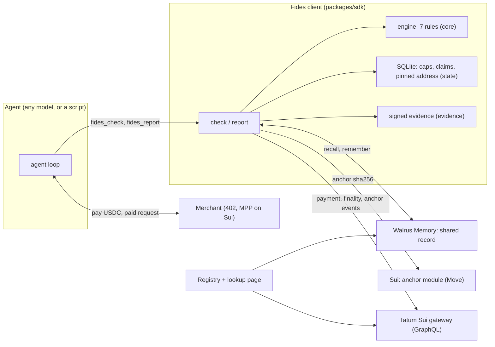

<p align="center"></p>

<h1 align="center">Fides</h1>

<p align="center"><strong>A credit bureau for machine payments on Sui.</strong><br>Agents check a merchant's record before they pay, and share signed reports of what they got.</p>

<p align="center"><a href="https://fides-credit-bureau.vercel.app">Live demo</a> · <a href="#judge-in-2-minutes">Judge in 2 minutes</a> · <a href="#honest-limits">Honest limits</a> · <a href="LICENSE">MIT</a></p>


*Fides* is Latin for trust and good faith. It is a credit bureau for machine payments on Sui: before an agent pays a merchant it asks "should I pay this?", and gets a verdict backed by evidence that other agents signed and sealed after real payments. (Not the Ethyca privacy tool of the same name: this repo is `fides-sui`.)

**The hard problem is not remembering what happened. It is letting an agent that has never met a merchant act on what another agent learned, without having to trust that other agent's word.** Every report here is signed by the agent that paid, anchored on Sui by the same address, and checked again by every reader against the chain, so a forged or copied report is rejected and shown, never believed.

Built for the Walrus x Tatum "Total Recall" hackathon, in the **Smart Agents for Real Life** track (its first example: a research agent with source trust scores), aiming at the Best Use of Agent Payments and Best Walrus Memory awards. [The research agent](#the-research-agent) · [Judge in 2 minutes](#judge-in-2-minutes) · [The core proof](#the-core-proof) · [Honest limits](#honest-limits) · [Run it](#run-it)

## Status

Built and tested on **Sui testnet** and run on **Sui mainnet** (2026-11-04): the anchor package `0x2e884850e268d67708d527770bbf3e9e991e0aa845c88c5b68bdaed62943696f` is published immutable, and the whole scripted demo ran on mainnet with real USDC payments, Tatum verification and the real Walrus Memory relayer: every expectation met ([`docs/evidence/demo-live-mainnet.txt`](docs/evidence/demo-live-mainnet.txt)). Then 15 trials in different circumstances ran on mainnet ([`docs/evidence/trials-mainnet.txt`](docs/evidence/trials-mainnet.txt)): 11 paid and reported, 3 refused, 1 declined by the person. These runs wrote 18 records (17 signed reports and the forged one). 14 are retrievable from the shared record on the relayer; the 4 written while an agent was detached are anchored on Sui only. The UI (research brief, decision feed, A/B split, source record with Re-verify, simulation board) is built, and ran on mainnet on 2026-11-05 ([`docs/evidence/demo-ui-mainnet.txt`](docs/evidence/demo-ui-mainnet.txt)). `pnpm web` runs it on **recorded fixtures** from the real engine; `pnpm web:live` runs the engine first and serves that run to it, with Re-verify checking records for real. A plain lookup page also ships with the registry, and the registry ran against the real relayer and Tatum on mainnet ([`docs/evidence/registry-mainnet.txt`](docs/evidence/registry-mainnet.txt)). Rule 6 was shown changing a real decision on mainnet ([`docs/evidence/demo-rule6-mainnet.txt`](docs/evidence/demo-rule6-mainnet.txt)). The research agent, the application on top, ran on mainnet on 2026-11-09 ([`docs/evidence/research-mainnet.txt`](docs/evidence/research-mainnet.txt)) and is the first screen of the UI. See [Honest limits](#honest-limits) and [`docs/ASSUMPTIONS.md`](docs/ASSUMPTIONS.md) for what is verified and what is not.

## The research agent

The application on top of Fides is a research agent that pays for its sources and remembers which ones to trust. Ask it a question and it buys from several paid sources. Before each purchase Fides decides from what other agents reported: pay, ask a person, or refuse. The result is a **brief** that says, for every source, what it delivered or why nothing was bought, and which signed reports the decision rested on. A source the agent did not trust is a labelled gap, never filled with anything.

`pnpm research` runs the story in five sessions: agent A researches and is burned by the news source, agent C is burned by it too, the signal source swaps its payout address, and then agent B, a new session that has never met any of them, researches the same question. B uses the price source, refuses the news source (two independent burns) and the signal source (the payout address changed), and loses nothing. Detached from the shared record, B asks a person about the news source and is burned like the others. It ran on Sui mainnet with real USDC and the Walrus Memory relayer on 2026-11-09, three complete times (7 payments of 0.01 USDC and 7 reports each): [`docs/evidence/research-mainnet.txt`](docs/evidence/research-mainnet.txt). The hosted site replays the latest run as its first screen. Each decision shows the memories it recalled with their distance (in that run, B's ASK on the price source cites two burns at the news source, at distances 0.371 and 0.382, limit 0.45). Those matched the pattern "new merchant", so the ASK is the one a new source gets anyway, and the brief says so; the rule 6 demo is the one that turns a PAY into an ASK. Every signed report the brief relied on or wrote opens as an evidence page with its five checks.

What a trust score means here, plainly: Fides judges whether a source **delivered what it promised** (the published format, fresh data, the quoted price, the expected payout address). It cannot judge whether the content is **true**; there is no ground truth in this project. The brief says "delivered as advertised", never "correct". The three sources are mock servers we run.

## Judge in 2 minutes

| | |
|---|---|
| Tests | 433 pass, 11 skipped (live network tests, Gemini included, and two slow simulation tests, run on request), typecheck clean |
| Research agent | `pnpm research` (simulated, free) or `FIDES_NETWORK=mainnet pnpm research -- --live --memory=live`. Output on mainnet: [`docs/evidence/research-mainnet.txt`](docs/evidence/research-mainnet.txt) |
| UI | Hosted: <https://fides-credit-bureau.vercel.app>. It is static, with no backend, and replays recordings of mainnet runs (the research agent from 2026-11-09, the scripted demo from 2026-11-05), labelled as recordings (real payments link to Suiscan; Re-verify replays the recorded checks). Locally: `pnpm web` opens the screens on recorded fixtures; `pnpm web:live` on a fresh run of the engine (add `-- --live` for Sui testnet); `pnpm mockups` serves the static design mockups |
| Real on-chain runs | the full demo on Sui mainnet with the real Walrus Memory relayer ([`docs/evidence/demo-live-mainnet.txt`](docs/evidence/demo-live-mainnet.txt)) and on testnet ([`docs/evidence/demo-live-testnet.txt`](docs/evidence/demo-live-testnet.txt)): real MPP USDC payments, Tatum verification, Sui anchors |
| Measured result | 20 agents, 6 merchants (2 bad): **6 burns with the shared record, 44 without** (86% avoided), no good merchant refused. [`docs/evidence/simulation.txt`](docs/evidence/simulation.txt) |
| Anchor module | mainnet `0x2e884850e268d67708d527770bbf3e9e991e0aa845c88c5b68bdaed62943696f` (immutable), testnet `0x1e58e339d2914686089424a956b34f22997d8cf5fac477f3604d05c027ae6b4a`, events of type `<package>::anchor::Report` |
| Not done | blog post and video |

```bash
pnpm install                 # Node 22 or newer, pnpm 11
pnpm test                    # 433 tests, no network, no keys
pnpm demo                    # the whole story, simulated: seconds, free
pnpm sim                     # 20 agents x 6 merchants, with and without the shared record
```

Real payments need keys and testnet funds: see [Run it](#run-it).

## The core proof

The scenario is the spec's demo, run on testnet with real payments. Agent A pays three merchants, then pays the flaky one again and gets junk. Agent C is burned too. Agent B has never met the flaky merchant, reads the shared record, and refuses. The malicious merchant swaps its payout address and quotes 4x. Then B loses access to the shared record, and is burned like the others. Then a real record is re-verified step by step and a forged one is rejected.

<details>
<summary>Verbatim output of the live testnet run (<code>pnpm demo:live</code>, memory kept in-process)</summary>

```text
Fides demo on testnet (live). Agents: A, B, C. Merchants: good, flaky, malicious.

== Step 1: Agent A, cold start, meets every merchant
  A -> good.fides-demo.test: ASK (cannot say: not enough history) [tier] -> person approves -> paid -> delivered as advertised -> reported clean 284dc881 (complete)
  A -> flaky.fides-demo.test: ASK (cannot say: not enough history) [tier] -> person approves -> paid -> delivered as advertised -> reported clean 9efed6a8 (complete)
  A -> malicious.fides-demo.test: ASK (cannot say: not enough history) [tier] -> person approves -> paid -> delivered as advertised -> reported clean faa83cb0 (complete)
  [ok] A asks about good and cannot say yet
  [ok] A pays good once and it delivers
  [ok] A asks about flaky and cannot say yet
  [ok] A pays flaky once and it delivers
  [ok] A asks about malicious and cannot say yet
  [ok] A pays malicious once and it delivers

== Step 2: A pays the flaky merchant again and gets junk
  A -> flaky.fides-demo.test: ASK (cannot say: not enough history) [tier] citing 9efed6a8 -> person approves -> paid -> BURNED (schema is "wrong/v0", expected fides.news/v1; data is missing or not an object) -> reported burn 5bcfb4d0 (complete)
  [ok] A is burned and reports a signed burn
  [ok] the burn is anchored on Sui and written to the shared record

== Step 3: C is burned too; B, who has never met flaky, reads the shared record and refuses
  C -> flaky.fides-demo.test: PAY_CAPPED [shared-burn] citing 5bcfb4d0 -> paid -> BURNED (asOf is 3600 s old, maximum is 120 s) -> reported burn 1c236e7c (complete)
  B -> flaky.fides-demo.test: REFUSE [shared-burns] citing 5bcfb4d0, 1c236e7c: not paid
  [ok] C is burned by the same merchant
  [ok] B refuses, citing both signed burns
  [ok] B pays nothing
  [ok] A's burn is one of the cited records

== Step 4: The malicious merchant swaps its payout address and quotes 4x
  A -> malicious.fides-demo.test: REFUSE (cannot say: not enough history) [address]: not paid
  B -> malicious.fides-demo.test: REFUSE (cannot say: not enough history) [address]: not paid
  [ok] A refuses: address changed from the one it paid, price jumped
  [ok] B refuses too, though it never paid this merchant: the pinned address comes from the shared record
  [ok] both raised an address alert

== Step 5: B detaches the shared memory: no access to it, nothing deleted
  B -> flaky.fides-demo.test: ASK (cannot say: not enough history) [tier] (shared record detached) -> person approves -> paid -> BURNED (schema is "wrong/v0", expected fides.news/v1; data is missing or not an object) -> reported burn aac63035 (complete)
  Detaching removes B's access to the shared record. Nothing was deleted from it.
  [ok] B no longer sees the burns: it can only ask a person
  [ok] B cites no shared records
  [ok] the person approves and B is burned: the same loss A and C had

== Step 6: Re-verify a real record, then reject a forged one
  re-verify format        ok   well formed, 1084 bytes, canonical
  re-verify hash          ok   sha256 9efed6a871e052df737248ecfbc25388039f7013db101892986f3b986dc7b4d5 matches the Sui anchor
  re-verify signature     ok   signed by reporter 0x1e27871ad624952bd034c7bb6b995f927ea494537603dc82b9fef6b537c6f4ec
  re-verify anchor-sender ok   anchor event sender equals the reporter
  re-verify payment       ok   final in checkpoint 400488473, sender is the reporter, 10000 paid to 0x6bb4c83392650cbd167bac4140ad7688a798a3c4347b0a21bf2d63a50de7071e
  forged record 9134818e: REJECTED, no anchor event found for this evidence (it may not be indexed yet)
  [ok] the anchor event for the record is found on Sui
  [ok] a real record passes every step of the re-verify
  [ok] the forged record is rejected and shown
  [ok] it changes nothing: B cites the same signed records and reaches the same decision

== Step 7: The shared record cannot be reached: B fails closed
  shared record unreachable: ASK [own-history] cites 1 record(s)
  [ok] while it is reachable B refuses flaky, citing the signed burns
  [ok] B is told the record is unreachable, not that there are no reports
  [ok] it will not pay: unreachable never softens a decision into a payment
  [ok] when the record comes back B refuses again, citing the same burns

== Cost of the burns (USDC)
  A: 0.01
  B: 0.01
  C: 0.01
  B lost nothing to flaky while attached (step 3), and lost the same as A and C once it detached (step 5).

All expectations met.
```

</details>

How to read it:

- **Step 3** is the point of the project. B pays nothing and cites two signed burns, by evidence id. One burn from another agent only *caps* a payment (that is what happened to C, who was burned anyway); a refusal takes two independent reporters.
- **Step 4**: B never paid the malicious merchant, yet it catches the address swap, because the address it compares with comes from verified clean reports in the shared record.
- **Step 5**: detaching means B loses access to the shared record (nothing is deleted). It has to ask a person, who approves, and B pays the same 0.01 USDC the others lost.
- **Step 6**: the "re-verify" lines are the checks any reader runs. The forged record (signed by a stranger, never anchored on Sui) is shown as rejected and changes nothing.
- **Step 7**: with the shared record unreachable B is told so, answers from its own history only, and will not pay. This step uses the in-process memory, so it shows the behaviour, not the real relayer failing.

And the measured effect, from the simulation (verbatim):

```text
Simulation: 20 agents, 6 merchants (4 good, 1 flaky, 1 malicious), 12 rounds, 3 seeds. Settlement simulated.

seed 1 shared   burns   2  paid 174  refused  54  asked  88
seed 1 detached burns  17  paid 192  refused   9  asked 231
seed 2 shared   burns   2  paid 170  refused  53  asked  91
seed 2 detached burns  14  paid 193  refused   8  asked 232
seed 3 shared   burns   2  paid 168  refused  56  asked  93
seed 3 detached burns  13  paid 184  refused  16  asked 224

                      with shared record   without
  burns                      6                44
  paid calls               512               569
  refused                  163                33
  ...of which good           0                 0   (the cost of caution)
  asked a person           272               687
  lost to burns (USDC)    0.06              0.44

The shared record avoided 38 of 44 burns (86%).

Rules that decided checks, with the record: tier 313, similar-incident 232, shared-burns 95, address 68, shared-burn 11, own-history 1
Rules that decided checks, without it:     tier 651, own-history 35, address 34
```

## The problem

Agents increasingly pay for things themselves: a server answers `402 Payment Required` with a price and an address, and the agent pays and retries. Three things go wrong. The merchant takes the money and returns junk. The merchant changes its payout address or raises its price. And every agent learns these lessons alone and loses money first: the knowledge dies with the agent.

## What was built

- **The guard:** a decision engine inside each agent. Before a payment it returns PAY, PAY_CAPPED, ASK (a person) or REFUSE, with reasons and citations.
- **The shared record:** after a payment the agent writes a signed, verified outcome to Walrus Memory and anchors its hash on Sui, so any other client can read and re-verify it.
- **Public surfaces:** an SDK, an MCP server (stdio and HTTP) and adapters for OpenAI, Anthropic, Gemini and OpenRouter, and a registry with a lookup page and a Re-verify button.
- **A test world:** three mock merchants (good, flaky, malicious), demo agents, and a simulation.

**The loop: check, pay, judge the response against what the merchant advertised, report, and the next agent to meet that merchant starts from what this one learned.**

## Architecture



Trust boundaries worth knowing: Walrus Memory is untrusted storage (any delegate can write anything), so every recalled report is checked against Sui (its anchor, written by the reporter) and Tatum (the payment, final, from the reporter, to the merchant) before it counts. Merchants verify payments through the MPP package's default fullnode, because Tatum's gRPC host cannot be used with it (see limits).

| Path | Role |
|---|---|
| `packages/core` | the engine: seven decision rules, trust scoring (Wilson interval, decay, reporter weights), config |
| `packages/evidence` | canonical JSON, signing, and the five-step verification (format, hash, signature, anchor sender, payment) |
| `packages/state` | SQLite via `node:sqlite`: atomic claims, daily cap, pinned address, evidence index, content-addressed copies, unreported-payment queue |
| `packages/memory` | the Walrus Memory wrapper: write rule, exact-host post-filtering, attached / detached / unreachable |
| `packages/chain` | Tatum GraphQL client (rate limited), payment and finality facts, anchor event reads |
| `packages/move` | the anchor Move module and publish script |
| `packages/sdk` | `fides.check`, `fides.report`, `lookup`, response checking, the simulated test world |
| `packages/tools`, `packages/mcp` | the three tools once, as MCP (stdio, HTTP) and as OpenAI / Anthropic / Gemini / OpenRouter adapters |
| `apps/merchants` | the good, flaky and malicious mock merchants (real HTTP, real MPP) |
| `apps/agent` | the paying agent loop, the scripted demo, the rule 6 demo and the research agent |
| `apps/sim` | the simulation |
| `apps/registry` | the read-only verifying registry and the lookup page |
| `apps/web` | the UI: Vite, React and TypeScript behind a `FidesApi` interface (fixtures, and live through a small loopback server in `apps/web/server`), plus the static mockups |

## How it decides

First matching rule wins, in this order:

1. **Budget:** today's spend plus this payment over the daily cap: ASK.
2. **Address:** the payout address differs from the pinned one: REFUSE if the price also jumped, otherwise ASK, and raise an alert.
3. **Price spike:** above 3x (new), 2x (established) or 1.5x (trusted) the typical price: ASK.
4. **Shared record:** two or more independent reporters with verified burns: REFUSE. One: PAY_CAPPED up to 0.05, or ASK above it.
5. **Own history:** burned by this merchant before: ASK once, REFUSE after two.
6. **Similar incidents:** recalled burn narratives of *other* merchants whose pattern matches this one: ASK, citing the memories.
7. **Tier:** established or trusted: PAY. New or unknown: ASK.

| Situation | Outcome |
|---|---|
| Too little history | ASK with `cannotSay: true`. Never a guess |
| Shared record unreachable | Other agents' reports are hidden and any PAY becomes ASK. It never softens a REFUSE |
| Shared record detached (the demo toggle) | Own reports only. Nothing is deleted |
| A shared report cannot be checked yet (Tatum down) | pending: not counted, not rejected, and a PAY becomes ASK |
| A shared report fails any check | shown as rejected with the reason, never counted |

Trust tiers come from verified outcomes, weighted by the reporter's own track record, decayed (14 day half-life, 30 day window), with one reporter's influence capped. Starting values are in [`packages/core/src/config.ts`](packages/core/src/config.ts) and are not yet calibrated: see limits.

## Tests

| Package | Tests | What they pin down |
|---|---|---|
| `core` | 61 | every rule (an own burn counts toward a shared refusal), cannot-say, fail-closed states, Wilson, weights, decay, caps, clock skew |
| `evidence` | 29 | canonical form, signature, forged and tampered records, a copied payment digest, a failed lookup |
| `state` | 16 | atomic claims across connections, idempotency, the pinned address, rejections kept visible |
| `memory` | 28 | the write rule, exact-host filtering, look-alike hosts, header/evidence mismatch, the three states |
| `chain` | 37 | rate limiting and retries, key never in a URL or error, injection refused, finality, anchor paging |
| `sdk` | 79 | the whole check/report loop, forgeries, pending vs rejected, partial failures and retries, rule 6 end to end |
| `tools`, `mcp` | 38 | the three tools, every vendor's tool shapes, MCP over memory, stdio and HTTP, auth and origin checks, rate limit and deadline |
| `merchants` | 26 | each merchant's behaviour, the address swap on the real MPP gate |
| `agent` | 31 | the buy loop, timeouts, refused and unknown payments, a merchant naming another host, reporting retries (inline and in the background), the full demo, the rule 6 demo, the research agent (gaps, burned content never shown, unreachable record stated, a cited memory that did not change the outcome) |
| `registry` | 30 | verification, forged records, tampered storage, outages, rate limits, page safety, anchors recall missed |
| `sim` | 4 | repeatability, and (on request) the result |
| `web` | 65 | every screen rendered, the UI's logic and its API on fixtures and live: attempts, the board per round, the split view's three states, Re-verify for real, a forged record, an unreachable server, every research record opening as evidence |
| **Total** | **444** | 433 run by default |

Live tests (a real relayer, Tatum testnet, real payments) run only with `FIDES_LIVE=1`. Everything else uses a simulated world: a fake ledger, in-process memory, real signatures, real HTTP between agents and merchants, the real engine. The headline demo and the live tests use real payments and a real chain; nothing in them is faked except where stated under [staged versus real](#staged-versus-real).

## Engineering decisions

- **Hash the fetched bytes, never a re-serialised object.** Records must already be canonical JSON, so what was signed is unambiguous. Pretty-printed or reordered bytes are rejected.
- **One payment counts once, and is as old as the payment.** A reporter who re-signs the same payment gets a duplicate that is rejected and shown. A report is dated by the earlier of its signed time and the payment's chain time, so an old payment cannot be passed off as fresh.
- **The reporter signs, and the anchor must come from the same address.** A copied payment digest in someone else's report fails because the payment's sender is not the reporter.
- **Fail loudly.** A failed lookup is an error or a pending state, never "no ratings". An unreachable shared record is a different state from an empty one.
- **Nobody can change the anchor's code.** The publish transaction hands the upgrade capability straight to Sui's `make_immutable`, so no key, including the agent key that publishes, can upgrade the module later. (The testnet package predates this and is still upgradeable by Agent A.)
- **The write rule.** Evidence is written only for a payment verified through Tatum and past finality. The anchor goes before the memory, so a reader never sees a memory it cannot check.
- **Exact state is local, meaning is shared.** Caps, claims and pinned addresses live in SQLite (atomic, `BEGIN IMMEDIATE`). Walrus Memory is fuzzy recall, so results are post-filtered by exact merchant host in code.
- **Tatum GraphQL, not JSON-RPC or gRPC.** The gateway serves GraphQL and gRPC only, and gRPC speaks plain gRPC where the MPP package speaks gRPC-web, so merchants verify through the default fullnode and Tatum verifies on the agent side.
- **A new agent inherits the pinned address and typical price from verified shared reports,** so it can catch an address swap at a merchant it has never paid.
- **`node:sqlite` over `better-sqlite3`:** no native build, which pnpm 11 blocks by default.
- **One set of tools, many routes.** MCP and the vendor adapters share one definition, so every model sees the same inputs and behaviour.

## Staged versus real

Read this before trusting any number.

- **The merchants are ours.** The good, flaky and malicious merchants are mock servers we wrote. The flaky failures are forced in the demo (junk, then stale), and the malicious merchant's address swap is triggered on demand through an admin endpoint. The payments to them, the verification, the anchors and the reports around them are real on testnet.
- **The demo's memory is in-process by default.** `pnpm demo:live` uses a real chain but keeps the shared memory in the process, so rehearsals do not write permanent memories. With `--memory=live` it uses the real relayer; that was run once on mainnet (2026-11-04). The outage step (7) cannot switch off the real relayer, so on that run it only checks the attached case; the outage itself is covered by the simulated demo and the tests.
- **The person who approves an ASK is a script** that says yes. The simulation's person says yes 80% of the time.
- **The simulation settles on a fake ledger** and its memory is in-process. Rule 6 on real embeddings is shown separately, by `pnpm demo:rule6 -- --live --memory=live`.
- **Three agents, not two,** because a refusal needs two independent reporters.
- **Small on mainnet.** On mainnet: the check 4 payment, the anchor publish, one full demo run, 15 trials, the UI run, the registry run, the rule 6 demo and four research runs (three complete, one that failed at the start). Each payment is 0.01 USDC, paid to our own merchant wallet; gas is a fraction of a cent per run. Development, the simulation and most testing ran on testnet or the simulated ledger.

## Honest limits

- **The research agent's trust scores are about delivery, not truth.** A source that returns well-formed, fresh, correctly priced nonsense scores as trustworthy. The three sources are our own mock servers, and the research agent uses no language model: the brief is built from what was bought and what Fides decided. The Research screen replays a recording; the live server (`pnpm web:live`) does not run the research agent and says so.

- **Mainnet runs** (2026-11-04): `pnpm day1:mainnet:run` (payment and anchor, `docs/DAY1.md`) and `FIDES_NETWORK=mainnet pnpm demo:live -- --memory=live` (the demo, `docs/evidence/demo-live-mainnet.txt`). Then `FIDES_NETWORK=mainnet pnpm trials -- --yes` (15 trials, `docs/evidence/trials-mainnet.txt`). These runs wrote 18 records: 14 are retrievable from the shared record on the relayer, and the 4 written while an agent was detached are anchored on Sui only. Earlier Walrus Memory test records are in a separate throwaway namespace. Later mainnet runs: the UI (`docs/evidence/demo-ui-mainnet.txt`), the registry, which only reads the UI run's record (`docs/evidence/registry-mainnet.txt`), the rule 6 demo (`docs/evidence/demo-rule6-mainnet.txt`) and the research agent (`docs/evidence/research-mainnet.txt`).
- **Proof of payment is not proof of bad service.** A payment shows money moved, not that the response was bad. A merchant can pay itself through its own agents to build clean reports (it costs gas), and an honest-looking agent can slander a merchant by paying and reporting a false burn. Mitigations: reporter weighting, a cap on one reporter's influence, two reporters for a refusal, response checks against the published schema. A burn counts against a merchant only if the reporter paid that merchant's pinned payout address, so a reporter cannot pay a wallet of its own and blame any host for the price of gas; the payout address inherited from the shared record is the one most independent reporters paid. Sybil and cluster detection is out of scope.
- **Merchant identity is the host the agent called.** The reference agent refuses a merchant whose schema names a different host than the URL, except on loopback, where the local mock merchants name themselves. An agent that reaches merchants through some other path must do the same check.
- **A payment that fails in an unknown way keeps its spend until the chain says otherwise.** If the payment call fails without proof that nothing was sent (a timeout after broadcast), the claim is marked unknown and still counts toward the daily cap. `fides.reconcileUnknown()` then looks, through Tatum, for a final transfer the agent sent after the claim for exactly that amount: found, the claim is paid; nothing after 10 minutes, the spend is released; a failed lookup changes nothing. The match is by amount and time, not by merchant, so two payments of the same amount in the same window could be swapped (the spend total is right either way). A signed transfer that is broadcast later than 10 minutes would not be caught.
- **Trust is slow.** With the spec's thresholds a merchant needs several independent, experienced reporters to reach "established". In the simulation that happened (93 automatic payments to good merchants in one seed, none without the record) but only at 20 agents; at 12 agents and 8 rounds it did not, and the three-agent demo never reaches it. Thresholds are not calibrated: easing them in the simulation raised automatic payments to good merchants from 273 to 389 and cut how often a person was asked from 272 to 115, with the same 6 burns, over three seeds ([`docs/evidence/sweep.txt`](docs/evidence/sweep.txt), re-measured 2026-11-09). That looks free only because the simulation's reporters are all honest: nobody slanders a merchant or washes its reputation, which is exactly what stricter thresholds guard against. The defaults are left at the spec values for that reason.
- **Similar-incident recall (rule 6) works on real embeddings in one demonstrated case, with eased thresholds.** `pnpm demo:rule6` ran on mainnet with the real relayer ([`docs/evidence/demo-rule6-mainnet.txt`](docs/evidence/demo-rule6-mainnet.txt)): an agent that would have paid a steady merchant was told to ask a person, citing a memory of a different merchant that betrayed after a clean streak (recall distance 0.375, limit 0.45). One case: the 0.45 cutoff rests on 17 reports whose distances all sit at 0.38 to 0.45 (the pattern tag does the discriminating), and the simulation shows rule 6 changes nothing measurable. The demo eases the trust thresholds so a short script can make a merchant established.
- **Recall is fuzzy and the registry can be incomplete.** It asks for up to 50 memories by meaning and filters by host. To catch what recall misses, it also reads the newest 150 anchor events on Sui (events cannot be filtered by merchant on chain) and lists any anchored report for the merchant whose record did not come back. Those are shown but not counted: without the signed record, the signature and the payment cannot be checked. Older anchors past those pages are not scanned.
- **Merchants verify through the default fullnode,** not Tatum, and Tatum's JSON-RPC is not served. Tatum is on the agent and registry side of verification.
- **A merchant that is malicious from its first response, to an agent with no shared reports, is not flagged by the address rule.**
- **What still gets through:** in the simulation, 6 burns remain with the record, partly the malicious merchant after its turn, when a person approves an ASK about the changed address.
- **The OpenAI, Anthropic and OpenRouter adapters are checked against the vendors' documentation, not against live APIs.** The Gemini adapter is checked live (2026-11-04): the model called `fides_check` and relayed the answer. The MCP server is verified with a real MCP client. There is no TLS in front of the HTTP MCP server; put one there.
- **The Walrus Memory relayer sees plaintext** (it encrypts with Seal after reading). Nothing private is stored: evidence is public by design. There is no documented delete, so "detach" means Fides stops using the record. The testnet staging relayer's certificate is broken: it serves a certificate for `*.up.railway.app` (checked 2026-11-04).
- **The UI shows one run, not a live feed.** `pnpm web:live` runs the scripted demo and the simulation when it starts and serves that run; it does not update as new payments happen. Re-verify does run now, against the chain, and so does the A / B toggle: each state asks the engine what agent B would decide at that moment, and the page says it is a live answer. The unreachable state needs the engine to switch the shared record off, which it cannot do to the real Walrus Memory relayer (`--memory=live`); there the page says so and keeps the recorded decision. Starting a new simulation or demo from the UI, and making a real payment or report from it, are not built. `pnpm web` uses recorded fixtures. A label in the header says which, on every page. Every screen is rendered with React in a test (happy-dom); the look was checked by hand in a browser.
- **Self-grading is measured in the simulation, where every merchant is ours.** With the shared record, when Fides paid without asking the answer was clean 99% of the time (282 of 285, three seeds); at the established and trusted tiers, 274 of 274. Without the record Fides never paid on its own, so there is nothing to grade. Those numbers come from honest simulated reporters and mock merchants, so they say the rules work as designed, not how they fare against real adversaries. A real agent grades itself with `fides.selfGrade()` once it passes `decisionId` to `report()` (the reference agent does); refusals are never graded, because nobody learns what would have happened.

More detail, with how each was measured, in [`docs/ASSUMPTIONS.md`](docs/ASSUMPTIONS.md) and [`docs/DAY1.md`](docs/DAY1.md).

## Tech stack

- **Chain and data:** Sui (testnet and mainnet), Move 2024 anchor module, Tatum Sui gateway (GraphQL), Walrus Memory (`@mysten-incubation/memwal` 0.1.9), `@mysten/sui` 2.37.0.
- **Payments:** MPP on Sui USDC via `@suimpp/mpp` 0.9.0 and `mppx` 0.4.12.
- **Runtime and checks:** Node 22 or newer (developed on 24.15), TypeScript 5.9.3, pnpm 11.21, Vitest 2.1.9, `tsx` 4.23.15, `node:sqlite`.
- **Model access:** `@modelcontextprotocol/sdk` 1.32.2, `zod` 4.x.

## Project layout

```text
packages/
  core/        engine and trust scoring
  evidence/    canonical JSON, signing, verification
  state/       SQLite state
  memory/      Walrus Memory wrapper
  chain/       Tatum client, network profiles (networks.json)
  move/        anchor.move, publish.mjs, deployments.json
  sdk/         fides.check / fides.report, simulated world
  tools/       the three tools and the vendor adapters
  mcp/         MCP server (stdio, HTTP)
apps/
  merchants/   mock merchants    agent/   paying agent and demo
  sim/         simulation        registry/   verifying registry and lookup page
  web/         the UI (src/), fixtures/, mockups/
scripts/       day1-mainnet.mjs, check-secrets.mjs, balances.mjs
docs/          SPEC-adjacent notes: DAY1, ASSUMPTIONS, INTEGRATIONS, evidence/
SPEC.md        the build spec
```

## Run it

```bash
pnpm install
cp .env.example .env              # names only; fill in locally. Never commit .env
pnpm test && pnpm typecheck

pnpm demo                         # simulated, no keys
pnpm sim                          # the simulation (pnpm sim -- --seeds=5)
pnpm merchants                    # the three mock merchants on 127.0.0.1:4101-4103
pnpm web                          # the UI on http://127.0.0.1:4500 (recorded fixtures)
pnpm web:live                     # the same UI on a fresh run of the engine (-- --live for Sui testnet)
pnpm registry                     # lookup page and API on http://127.0.0.1:4200
pnpm research                     # the research agent over five sessions, simulated (-- --live --memory=live on mainnet; --json=path saves the run)
pnpm demo:rule6                   # a PAY that becomes an ASK, citing a memory of another merchant (-- --live --memory=live on mainnet)
pnpm web:build:hosted             # the UI build the hosted site uses (the recorded mainnet run)
node scripts/balances.mjs         # SUI and USDC balance of each wallet, read-only
pnpm --filter @fides/mcp start    # MCP over stdio (add -- --http, with FIDES_MCP_TOKEN, for HTTP)
```

For a real run you need, in `.env`: `FIDES_DAILY_CAP_USD`, `SUI_PRIVATE_KEY_A` / `_B` / `_C` / `_MERCHANTS`, `TATUM_TESTNET_API_KEY` (and `TATUM_MAINNET_API_KEY`), and for the real shared memory `MEMWAL_ACCOUNT_ID` and `MEMWAL_KEY_A` / `_B`. `packages/evidence/gen-wallets.mjs` generates wallet keys. `FIDES_LOG=json` adds structured logs on stderr, one JSON object per line, for payments, claims, reports, retries and rejected evidence. Then:

```bash
pnpm demo:live                          # real testnet payments, memory in-process
pnpm demo:live -- --memory=live         # also writes real Walrus Memory (permanent)
pnpm day1:mainnet                       # mainnet preflight: spends nothing, says what is missing
```

Using Fides from OpenAI, Claude, Gemini or OpenRouter: [`docs/INTEGRATIONS.md`](docs/INTEGRATIONS.md).

## Attribution

- Walrus Memory ([`@mysten-incubation/memwal`](https://www.npmjs.com/package/@mysten-incubation/memwal)), Walrus and Sui by Mysten Labs.
- Tatum's Sui gateway ([docs.tatum.io](https://docs.tatum.io)).
- MPP on Sui: [`@suimpp/mpp`](https://www.npmjs.com/package/@suimpp/mpp) and [`mppx`](https://www.npmjs.com/package/mppx).
- [`@modelcontextprotocol/sdk`](https://www.npmjs.com/package/@modelcontextprotocol/sdk), [`zod`](https://www.npmjs.com/package/zod), [Vitest](https://vitest.dev), [`tsx`](https://www.npmjs.com/package/tsx).
- **Built with an AI coding agent.** Claude Code (Claude Sonnet 5.5) wrote most of the code and tests in this repository, working from `SPEC.md` and the author's direction. The design, the decisions, the funding and all on-chain actions were the author's to approve.

## License

MIT. See [`LICENSE`](LICENSE).
